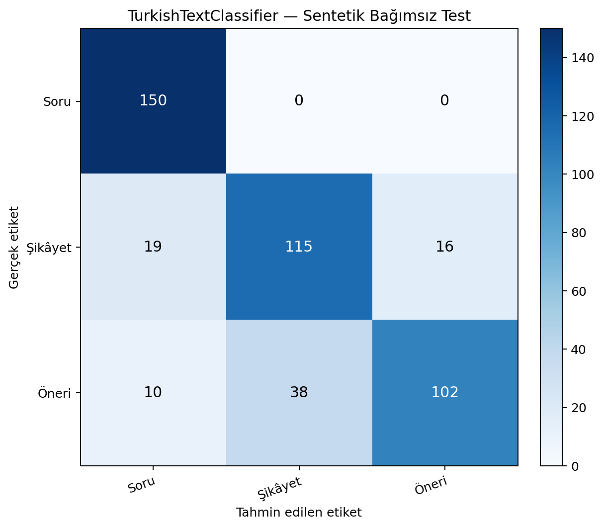

# TurkishTextClassifier

Lightweight Turkish-language intent classification for short user messages. The supplied trained model maps each input sentence to one of three classes: **Soru** (question), **Şikâyet** (complaint), or **Öneri** (suggestion). The repository includes the original training pipeline and datasets, the fitted scikit-learn pipeline, a local CLI/HTTP inference service, and an independent synthetic evaluation benchmark with recorded predictions and error analysis.

> **License note:** This project is open-source and released under the [MIT License](LICENSE) (Copyright © 2026 wineglyph).

## Project objectives

- Classify Turkish customer-service and feedback messages by primary communicative intent.
- Provide a compact, local inference path for CLI, Python, and HTTP service use.
- Preserve the original trained model and its datasets.
- Maintain reproducible documentation and independent evaluation material without mixing the synthetic benchmark into training data.

## Classification categories

| Label | Meaning | Typical intent |
|---|---|---|
| `Soru` | Question | Ask for information, explanation, clarification, status, or process details |
| `Şikâyet` | Complaint | Express dissatisfaction with an existing issue, negative experience, delay, or service failure |
| `Öneri` | Suggestion | Propose an improvement, feature, change, or new idea |

The model predicts one primary class; it is not a general sentiment classifier and does not support unrestricted multi-label classification.

## Main features

- Turkish-aware lowercasing that preserves dotted/dotless `i` behavior.
- Unicode NFKC normalization, punctuation cleanup, and whitespace normalization.
- TF-IDF word unigrams/bigrams with sublinear term-frequency scaling.
- Balanced Logistic Regression classifier in the scikit-learn production pipeline.
- CLI, Python service class, and lightweight HTTP inference endpoints.
- Original data/training reports plus a separate 450-row synthetic evaluation set.

## Architecture and methodology

The production inference path in `src/model/predict.py` loads `artifacts/model/turkish_text_classifier.joblib`. The serialized pipeline applies the project's `preprocess_turkish_text` function inside `TfidfVectorizer` (word n-grams `(1, 2)`, `sublinear_tf=True`) and feeds those features to balanced Logistic Regression (`C=2.0`, `lbfgs`).

The training script (`src/model/train.py`) compares candidate classifiers, fits the selected Logistic Regression pipeline, and writes model/report artifacts. **Training is not needed for inference.** The project was not retrained or modified during this consolidation.

## Dataset composition

### Original project data

| File | Examples | Description |
|---|---:|---|
| `data/turkish_text_dataset.csv` | 1,922 | Complete corpus, fields `text`, `label`, `domain` |
| `data/turkish_text_dataset.jsonl` | 1,922 | JSONL representation of the corpus |
| `data/train.csv` | 1,537 | Original training split |
| `data/test.csv` | 385 | Original held-out test split |
| `test_samples_20.json` | 25 | Manually prepared examples (despite the filename) |

The full corpus has 756 `Soru`, 632 `Şikâyet`, and 534 `Öneri` examples. The supplied project documentation describes ten domains. The separate validation split was not present in the original archive. See [Dataset Card](docs/DATASET_CARD.md) for provenance, intended use, and rights caveats.

### Independent synthetic evaluation data

`external_eval/synthetic_test.csv` contains exactly 450 synthetically generated Turkish examples, balanced at 150 per category. It spans ten domains (45 each) and five writing styles (90 each). It is a separate held-out evaluation candidate, not a training dataset. The folder also contains its quality report, metadata, validation script, generated predictions, metrics, confusion matrix, and individual error analysis. The aggregate 450/450 second-pass label-review claim from earlier working notes is not independently verifiable because per-example review decisions were not retained; this limitation is now documented in the quality report.

## Installation

Python 3.11+ is recommended. Install dependencies from the repository root:

```bash
python -m venv .venv
source .venv/bin/activate        # Windows instructions: see docs/INSTALLATION.md
python -m pip install --upgrade pip
python -m pip install -r requirements.txt
```

The serialized scikit-learn model reports a save-time version of **1.9.1**. `requirements.txt` pins that version to avoid the cross-version warning observed when it was loaded with scikit-learn 1.8.0. No clean installation/reproduction under 1.9.1 was performed during consolidation; see [Compatibility and Provenance](docs/COMPATIBILITY_AND_PROVENANCE.md).

More details: [Installation Guide](docs/INSTALLATION.md).

## Usage

Run commands from the project root so the existing relative artifact paths resolve.

### CLI

```bash
python src/model/predict.py --text "Siparişim ne zaman kargoya verilir acaba?"
python src/model/predict.py --text "Ürünün kutusu hasarlı geldi." --json
```

### Python API

```python
from pathlib import Path
import sys

PROJECT_ROOT = Path.cwd()
sys.path.insert(0, str(PROJECT_ROOT / "src" / "model"))
from predict import TurkishTextClassifierService

classifier = TurkishTextClassifierService(
    model_dir=str(PROJECT_ROOT / "artifacts" / "model")
)
result = classifier.predict("Faturam neden beklediğimden yüksek geldi?")
print(result["prediction"], result["confidence"])
```

### Local HTTP API

Start the built-in HTTP server:

```bash
python src/serve.py 8080
```

Health check:

```bash
curl http://127.0.0.1:8080/health
```

Predict:

```bash
curl -X POST http://127.0.0.1:8080/inference/predict \
  -H "Content-Type: application/json" \
  -d '{"text":"Kargom üç gündür dağıtıma çıkmadı."}'
```

The service also accepts a `texts` array for batch requests. It binds to `0.0.0.0` and has no authentication; keep it on a trusted network or add an appropriate security layer before exposing it.

### Demo

```bash
python run_demo.py
```

## Evaluation results

The figures below come from distinct test sets and must not be interpreted as a controlled comparison or a real-world production accuracy estimate.

| Evaluation set | Examples | Correct | Accuracy | Macro F1 |
|---|---:|---:|---:|---:|
| Original internal held-out test | 385 | 384 | 99.74% | 99.71% |
| Previous manually prepared test | 25 | 24 | 96.00% | Not reported |
| Independent synthetic test | 450 | 367 | 81.56% | 81.07% |

The independent synthetic evaluation produced a weighted F1 of 81.07%. Per-class synthetic F1 was 91.19% for `Soru`, 75.91% for `Şikâyet`, and 76.12% for `Öneri`. There were 83 errors. The largest confusion was `Öneri` predicted as `Şikâyet` (38 examples).

### Independent synthetic confusion matrix

Rows are gold labels; columns are model predictions. Label order: `Soru`, `Şikâyet`, `Öneri`.



Full details: [Evaluation Report](external_eval/results/EVALUATION_REPORT.md), [Error Analysis](external_eval/results/ERROR_ANALYSIS.md), and [Machine-readable metrics](external_eval/results/evaluation_metrics.json).

## Compatibility warning

The evaluation pipeline loaded successfully and predicted all 450 items, but its runtime was scikit-learn 1.8.0 while the serialized estimators report 1.9.1. An `InconsistentVersionWarning` was emitted. The measured results are actual outputs from that run, but cross-version deserialization is a reproducibility caveat. Re-run in the pinned artifact-matching environment before relying on strict bit-for-bit reproducibility. No compatibility rerun is claimed here.

## Known limitations

- The independent evaluation set is synthetic and balanced; it does not estimate live production traffic performance.
- The original and manual test sets have different sources and sizes, so headline accuracies are not directly comparable.
- The model is a three-class intent classifier, not a general sentiment model or multi-intent system.
- Very short, ambiguous, sarcastic, or mixed-intent messages may be difficult to classify.
- Confidence values are the winning class probabilities returned by the model; calibration has not been independently assessed.
- The model's serialized scikit-learn version differs from the evaluation runtime, as described above.
- Original dataset and repository redistribution rights are not legally established by a supplied `LICENSE` file.

## Future development ideas

- Re-run the saved evaluation using the exact serialized dependency versions.
- Obtain independent human annotation for a naturally sourced, rights-cleared Turkish benchmark.
- Add confidence calibration and abstention/low-confidence routing.
- Examine domain and writing-style shifts with additional held-out data.
- Add automated regression tests for preprocessing, inference parity, and packaging.
- Confirm repository/data ownership and publish an explicit license/attribution statement.

## Project structure

```text
TurkishTextClassifier/
├── artifacts/model/            # Existing fitted artifacts and configs
├── artifacts/reports/          # Original evaluation and test reports
├── data/                       # Original corpus, train/test splits, raw staging
├── docs/                       # Model, dataset, installation, structure docs
├── external_eval/              # Independent synthetic evaluation and results
├── scripts/                    # Project verification utility
├── src/dataset/                # Original dataset scripts
├── src/model/                  # Training, preprocessing and prediction
├── src/serve.py                # Lightweight HTTP inference server
├── tests/                      # Packaging smoke tests
├── run_demo.py
└── test_samples_20.json         # 25 manually prepared inputs
```

See [full structure](docs/PROJECT_STRUCTURE.md), [final manifest](FINAL_MANIFEST.md), and [SHA-256 checksums](SHA256SUMS.txt).

## License

This project is licensed under the **MIT License** — see the [LICENSE](LICENSE) file for the full license text.

Copyright (c) 2026 wineglyph.
