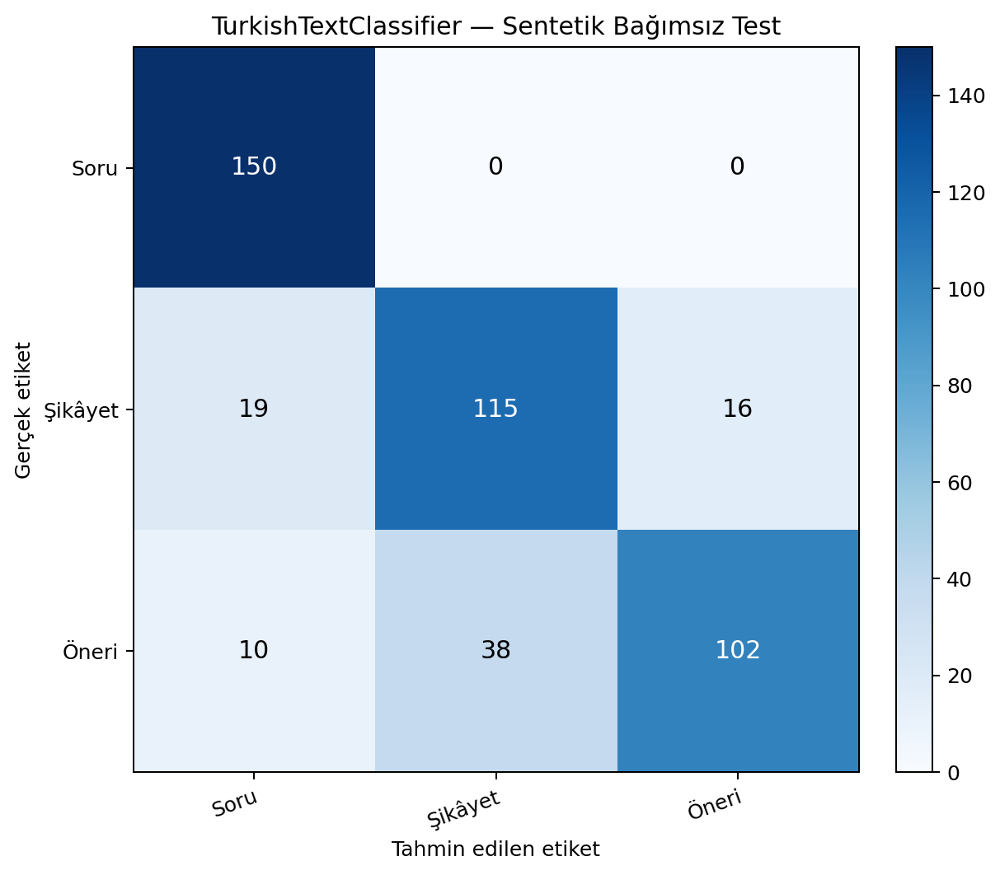

# TurkishTextClassifier — Independent Synthetic Evaluation Report

**Evaluation date:** 2026-11-01 (Europe/Istanbul)  
**Outcome:** 450/450 rows received a prediction; 367 correct and 83 incorrect.  
**Scope:** inference and reporting only; no training, fine-tuning, model changes, or model improvement were performed.

## 1. Model and inference method

The inspected project exposes `TurkishTextClassifierService` in `src/model/predict.py`. Its backend is `sklearn`. `src/serve.py` uses this service path. The evaluated production path was:

`TurkishTextClassifierService.predict_batch(texts)`

Primary loaded model artifact: `artifacts/model/turkish_text_classifier.joblib`. It contains the fitted scikit-learn pipeline: Turkish preprocessing within `TfidfVectorizer` (word unigrams and bigrams, sublinear TF scaling) followed by balanced Logistic Regression (`C=2.0`, `lbfgs`). The existing `predict()` method obtains `predict_proba`, selects `argmax`, and returns the winning class and confidence.

### Input isolation

Before inference, the evaluation process read only the CSV `text` column. It submitted those 450 strings to `predict_batch`. Only after all 450 predictions had been returned did the process read `gold_label`, `id`, and descriptive metadata to score predictions. The gold labels were never passed to the classifier. The project preprocessing and prediction code were not changed.

## 2. Dataset

Input: `external_eval/synthetic_test.csv`. It contains 450 synthetically generated Turkish messages: 150 `Soru`, 150 `Şikâyet`, and 150 `Öneri`. There are 10 domains with 45 items each, and five writing-style groups with 90 items each. This is an intentionally balanced synthetic benchmark, not a sample of naturally occurring production traffic.

## 3. Overall performance

| Metric | Result |
|---|---:|
| Accuracy | **81.5556%** |
| Macro precision | 81.8010% |
| Macro recall | 81.5556% |
| Macro F1 | **81.0708%** |
| Weighted F1 | 81.0708% |
| Correct predictions | 367 / 450 |
| Incorrect predictions | 83 / 450 |

## 4. Per-class results

| Class | Precision | Recall | F1 | Support | Correct |
|---|---:|---:|---:|---:|---:|
| Soru | 83.7989% | 100.0000% | 91.1854% | 150 | 150 |
| Şikâyet | 75.1634% | 76.6667% | 75.9076% | 150 | 115 |
| Öneri | 86.4407% | 68.0000% | 76.1194% | 150 | 102 |

## 5. Confusion matrix

Rows are gold labels; columns are predicted labels. Both axes use the required order: `Soru`, `Şikâyet`, `Öneri`.

| Gold \ Predicted | Soru | Şikâyet | Öneri |
|---|---:|---:|---:|
| Soru | 150 | 0 | 0 |
| Şikâyet | 19 | 115 | 16 |
| Öneri | 10 | 38 | 102 |

## 6. Domain and writing-style results

Each domain has 45 items. These are descriptive slices of the synthetic benchmark and should not be read as estimates of real-world domain accuracy.

| Domain | Correct / 45 | Accuracy |
|---|---:|---:|
| Bankacılık ve finans | 39/45 | 86.67% |
| Belediye hizmetleri | 38/45 | 84.44% |
| E-ticaret | 37/45 | 82.22% |
| Eğitim | 35/45 | 77.78% |
| Kargo ve lojistik | 39/45 | 86.67% |
| Restoran ve konaklama | 37/45 | 82.22% |
| Sağlık hizmetleri | 34/45 | 75.56% |
| Telekomünikasyon | 39/45 | 86.67% |
| Ulaşım | 31/45 | 68.89% |
| Yazılım ve mobil uygulamalar | 38/45 | 84.44% |

| Writing style | Correct / 90 | Accuracy |
|---|---:|---:|
| Ayrıntılı anlatım | 72/90 | 80.00% |
| Günlük konuşma | 72/90 | 80.00% |
| Kısa ve doğrudan | 70/90 | 77.78% |
| Resmî / kurumsal | 79/90 | 87.78% |
| Yazım varyasyonlu | 74/90 | 82.22% |

## 7. Error analysis

There are 83 misclassifications. The largest single confusion is `Öneri` → `Şikâyet` (38 examples), followed by `Şikâyet` → `Soru` (19), `Şikâyet` → `Öneri` (16), and `Öneri` → `Soru` (10). No gold `Soru` item was missed.

All 83 incorrect items, including sentence, gold label, predicted label, confidence, and a likely text-based explanation, are documented in [ERROR_ANALYSIS.md](ERROR_ANALYSIS.md). The explanations are hypotheses, not introspective model explanations.

## 8. Comparison with earlier project-reported results

| Evaluation | Examples | Accuracy | Macro F1 | Weighted F1 |
|---|---:|---:|---:|---:|
| Existing held-out test (project report) | 385 | 99.74% (384/385) | 99.71% | 99.74% |
| Existing manual test (project report) | 25 | 96.00% (24/25) | Not reported | Not reported |
| This independent synthetic set | 450 | 81.56% (367/450) | 81.07% | 81.07% |

Previous figures are read from `artifacts/reports/evaluation_report.json`, `artifacts/reports/manual_test_results.json`, and the project README/model card. They were not re-run as part of this task. The synthetic accuracy is 18.18 percentage points below the reported held-out test accuracy and 14.44 points below the reported manual-set accuracy. These datasets differ in source, size, balance, and construction, so the comparison is contextual rather than a controlled head-to-head experiment.

## 9. Integrity and reproducibility

- 450 inputs were submitted and 450 predictions were returned.
- The model weights and other model artifacts were SHA-256 hashed before and after inference. All 7 files under `artifacts/model/` retained identical hashes.
- All 4 files under the original `data/` directory were SHA-256 hashed before and after; all hashes remained identical.
- No training, fine-tuning, training script execution, preprocessing edits, dataset edits, or weight writes were performed.
- Gold labels were first read only after all predictions had been generated.

### Environment warning

Loading the serialized scikit-learn pipeline emitted `InconsistentVersionWarning`: the stored estimators report scikit-learn **1.9.1**, while the runtime used for this evaluation is **1.8.0**. The artifact loaded successfully and returned predictions for all examples, but scikit-learn warns that cross-version unpickling can produce compatibility risks. No dependency was installed or changed. For strict reproducibility, repeat this same inference in an environment matching the artifact serialization version, then compare the predictions.

### Confidence

The existing API returned confidence for every example. `predictions.csv` stores its `confidence` field as returned by `predict()` (rounded to four decimal places). This is the maximum class probability, not a separately calibrated probability of correctness. Mean confidence was 0.7013 for correct items and 0.4443 for incorrect items.

## 10. Limitations

- All evaluation examples are synthetic. The measured metrics do not establish performance on real customer messages or future production traffic.
- A balanced class distribution does not represent likely deployment prevalence; precision and accuracy may change under a different class mix.
- The model’s scikit-learn serialization/runtime version mismatch is a material reproducibility caveat.
- Error explanations are qualitative hypotheses; they are not causal attributions from the model.
- The result reflects the project’s current default sklearn backend only; the optional PyTorch backend was not evaluated.

## 11. Output files

- `predictions.csv` — one prediction per test row, including confidence and correctness.
- `evaluation_metrics.json` — aggregate/per-class metrics, confusion matrix, distributions, runtime and integrity details.
- `confusion_matrix.png` — confusion matrix visualization.
- `ERROR_ANALYSIS.md` — all 83 misclassified examples and recurring patterns.
- `EVALUATION_REPORT.md` — this report.
